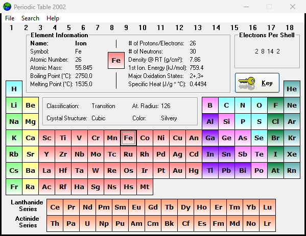
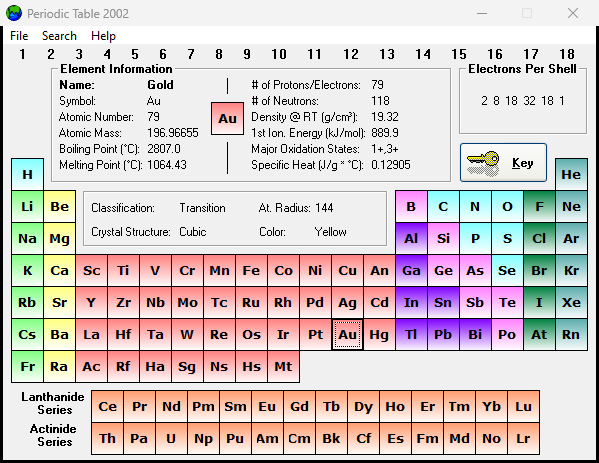

# Periodic Table 2002, recompiled

Static recompilation of **Periodic Table 2002** 1.2.1 (Clint Garafolo, 2002-2004),
a Visual Basic 6 periodic table reference, from its shipping Win32 executable
to native C. No emulator, no wrapper DLLs. It is pcrecomp's first Visual Basic
program: the VB6 code is lifted, and Microsoft's own VB6 runtime
(`msvbvm60.dll`) runs beside it as a native module.

Built on the [pcrecomp](https://github.com/sp00nznet/pcrecomp) toolchain and
following its shared house style (layout, CLI, conformance harness), like the
other [pcrecomp projects](https://github.com/sp00nznet/pcrecomp#the-projects-that-built-this).

## What it is

A static recompilation of `Periodic_Table_2002.exe` (Visual Basic 6,
**native code**, not P-code: its VB header's `ProjectInfo.lpNativeCode` is
set and every procedure is x86). Its 912 procedures and runtime stubs are
lifted to C by pcrecomp, compiled with MSVC, and run on pcrecomp's `native32`
host, which calls the real `msvbvm60.dll` (and through it the program's OCX
controls) with the guest's registers and stack. It runs the author's code; it
is not a rewrite.

## Status: v0.1.0, alpha. It opens, shows an element, and searches, pixel-identical to the original

| Stage | State |
|---|---|
| Version recompiled | Periodic Table 2002 1.2.1 (`Periodic Table 2002.msi`, exe stamped 2004-09-16), trialware |
| VB header (`tools/pe/vb6.py`) | native code, 5 objects (3 forms, 2 modules), 133 event handlers |
| Function catalog (`disasm32`) | 991 entries; 760 kept in the VB code range, the rest of `.text` is VB data |
| Lift (`run_lift.py`) | 912 functions, 0 errors, 9 procedures with `On Error` landing pads |
| Host (`build/periodictablerecomp.exe`, 32-bit, pcrecomp `native32`) | 99 imports (all `msvbvm60.dll`): 80 native, 19 shimmed, 0 unresolved |
| Startup, trial check, main form | works, matches the original |
| Element details (click an element) | works, matches the original |
| Search > Search Elements | works, matches the original |
| VB runtime errors (`On Error Resume Next` / `GoTo`) | work: three are raised and handled at every startup, as in the original |
| Print, Check for Update, Key, About | not yet checked |
| Headless mode (`--headless --record`) | not yet ([ROADMAP.md](ROADMAP.md)); the harness runs on a hidden desktop instead |
| Conformance harness | `tools/pt_diff.py`: **3/3** steps pixel-IDENTICAL on a machine with the program; SKIP without it |

Built and tested against pcrecomp branch `pcrecomp-periodictable` (the VB6
runtime support; not merged yet).

It is trialware: the program counts its own 5-day trial in
`HKCU\Software\Periodic Table 2002` and nags when it ends. The recompilation
does not touch that, and the harness runs both programs with whatever trial
state the machine has.

## Screenshots

An element's details and a search, running as recompiled native code:





## What is not in this repo

Nothing of Periodic Table 2002 or of Microsoft's VB6 runtime: no executable,
no OCX, and **no generated source**. The recompiled C is produced on your
machine from your own copy by `run_lift.py`, into `src/recomp/gen/`, which is
gitignored.

## Getting Started

You need **your own copy of Periodic Table 2002 1.2.1**: `Periodic Table
2002.msi` (on the Internet Archive in the Tucows collection, item
`tucows_363354_Periodic_Table_2002`), or the folder it installed to. You do not
have to install it: Setup unpacks the .msi with `msiexec /a`, which installs
nothing. The .msi also carries the four OCX controls the program uses (its
own `PowerButton.ocx` and `activelock1884.ocx`, and Microsoft's
`comdlg32.ocx` and `msinet.ocx`); `msvbvm60.dll` ships with Windows.

### Quick start: Setup.cmd

1. Download this repository (the green **Code** button, then **Download ZIP**)
   and unzip it somewhere with 300 MB free.
2. Double-click **`Setup.cmd`**.

It checks for Python 3.10+, the `pefile` and `capstone` packages, the pcrecomp
toolkit and the Visual Studio 2022 C++ compiler, and **asks** before
installing any of them, saying what and how big. It asks where the .msi (or
the installed folder) is (`Setup.cmd -GameDir <path>` skips the question,
`-Yes` answers yes to every install). Then it copies the program and its
controls into `game\` (and the exe into `work\`), writes the controls'
manifest, finds
every function, recompiles it and builds `build\periodictablerecomp.exe`. A
rerun skips the finished steps. If it stops, it says why in one sentence, and
the details are in `setup.log`.

It ends with a **`Periodic Table 2002`** shortcut in the folder. Double-click
it to run the recompiled program.

### Step by step

Prerequisites: Python 3.10+ (`py -3`, or `python`; the Microsoft Store's
`python` alias is not Python), `pip install pefile capstone pillow`, Visual
Studio 2022 or its Build Tools with "Desktop development with C++" (CMake and
Ninja come with it), and the toolkit beside this folder:

```
  some-folder\
    pcrecomp\        <- git clone -b pcrecomp-periodictable https://github.com/sp00nznet/pcrecomp
    periodictable\   <- this repository
```

1. Unpack the .msi (nothing is installed) and copy the exe, as
   `Periodic_Table_2002.exe`, and the four controls into `game\`, and the exe
   into `work\` too:
   ```
   msiexec /a "C:\path\Periodic Table 2002.msi" /qn TARGETDIR=%TEMP%\pt2002
   mkdir game work
   copy "%TEMP%\pt2002\Program Files\Periodic Table 2002\Periodic Table 2002.exe" game\Periodic_Table_2002.exe
   copy "%TEMP%\pt2002\Program Files\Common Files\*.ocx" game\
   copy "%TEMP%\pt2002\Windows\System32\Redist\MS\System\comdlg32.ocx" game\
   copy "%TEMP%\pt2002\Windows\System32\Redist\MS\System\msinet.ocx" game\
   copy game\Periodic_Table_2002.exe work\
   ```
2. Write the manifest that names every control (nothing is registered):
   ```
   py -3 -I tools\make_manifest.py game
   ```
   Expected: `wrote game\Periodic_Table_2002.exe.manifest`.
3. Catalog the functions:
   ```
   py -3 ..\pcrecomp\tools\disasm\disasm32.py work\Periodic_Table_2002.exe -o work\functions.json
   ```
   Expected, last lines: `Functions: 991` ... `Wrote work/functions.json`.
4. Lift:
   ```
   py -3 run_lift.py
   ```
   Expected: `lifted 912 (+0 outside the catalog)   errors 0 ... catch 9`.
5. Build (the compiler is found by `build.cmd`):
   ```
   build.cmd
   ```
   Expected: `Linking C executable periodictablerecomp.exe`.
6. Run:
   ```
   build\periodictablerecomp.exe --run
   ```

Trip-ups: `run_lift.py` and `build.cmd` look for the toolkit at
`..\pcrecomp`; set `PCRECOMP` (and `CMAKE_ARGS=-DPCRECOMP=...`) if it is
elsewhere. "Error 339: Component ... not correctly registered" means an OCX or
the manifest is missing from `game\`.

## Usage

```
build\periodictablerecomp.exe --run                    # the program
build\periodictablerecomp.exe                          # map and bind only, then stop
build\periodictablerecomp.exe --run --watchdog 60      # end it after 60 s
build\periodictablerecomp.exe --run --native-trace     # every call into msvbvm60, to stderr
set NATIVE32_TRACE_EH=1                                # trace VB runtime errors and where they resume
py -3 -I tools\pt_diff.py                              # the conformance check, below
```

### Conformance

`tools/pt_diff.py` runs the same script on the original and on the recomp, on
a hidden desktop (nothing reaches your screens): wait for the main window,
click **Fe**, then **Search > Search Elements**, type `Au`, OK. After each step
it captures the main window and compares the two pictures pixel for pixel
(the element panel is drawn with windowless VB labels, so the pixels are the
text). Current figure: **3/3 IDENTICAL**. Without `game\` it prints SKIP and
exits 0.

## Building from source

The steps above are the build. The host is `src/runtime/host.c` (from the
AmazingMIDI recomp's); the lift driver is `run_lift.py`, which keeps only the
code a VB6 exe really has (pcrecomp `tools/pe/vb6.py`): the native code range,
the event and Declare stubs, and gives each procedure with `On Error` a
landing pad for the runtime's resume points. [docs/bringup.md](docs/bringup.md)
has the story of each piece.

## License

MIT, see [LICENSE](LICENSE). Periodic Table 2002 is (c) Clint Garafolo /
GarfInc; the VB6 runtime and controls are (c) Microsoft. See [NOTICE](NOTICE).
